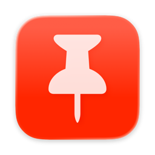
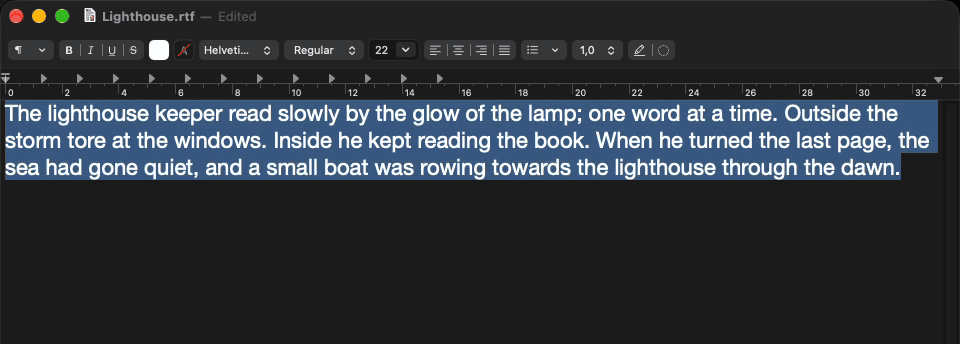

<p align="center">
  
</p>

<h1 align="center">Pin</h1>

<p align="center">
  Speed reading for macOS. Select text anywhere, press a hotkey, read it word by word.
</p>

<p align="center">
  
</p>

---

Pin lives in the menu bar and uses [RSVP](https://en.wikipedia.org/wiki/Rapid_serial_visual_presentation) (Rapid Serial Visual Presentation) to display text one word at a time at a fixed focal point. It captures selected text from any application via the macOS Accessibility API, so there is nothing to copy and paste.

- Global hotkey (default: Option+Space) to start reading selected text
- Optimal Recognition Point (ORP) highlighting based on the Spritz algorithm
- Configurable speed (50-1000 WPM), sentence and clause pausing, ramp-up start
- Floating HUD panel with vibrancy, movable and multi-monitor aware
- No dependencies, no network requests, no tracking

Pin reads the selection through the Accessibility API. In apps that do not expose it, Pin falls back to a simulated Cmd+C and restores the clipboard afterwards. If you run a clipboard manager, it will see that text.

Requires macOS 26.0 (Tahoe) or later.

## Install

Pin is free. You can download a build or build it yourself.

### Download

1. Download the latest `Pin-vX.Y.Z.zip` from [Releases](https://github.com/floschu/pin/releases) and move `Pin.app` to `/Applications` before you open it. If you open it from Downloads, macOS runs it from a temporary read-only copy.
2. The app is not notarized, so macOS blocks it on first launch. Open it once, then go to System Settings > Privacy & Security and click "Open Anyway".
   Or remove the quarantine flag in Terminal: `xattr -dr com.apple.quarantine /Applications/Pin.app`
3. Grant Accessibility access when Pin asks for it.

Every new version has a new signature, so macOS asks for Accessibility access again after an update. The old entry in System Settings may still look enabled, but it no longer applies. If Pin shows the permission as not granted, click Request Permission in Pin's Settings > General. Pin then removes the old entry and asks again.

### Build from source

```
brew install xcodegen
xcodegen generate
open Pin.xcodeproj
```

Then press Run in Xcode. No Apple Developer account needed. See [CONTRIBUTING.md](CONTRIBUTING.md) for details.

## Privacy

Last updated: October 2026

This policy applies to the Pin app for macOS, made by Florian Schuster. Pin is free and open source, and all of its source code is in this repository.

**Data collection.** Pin does not collect, store, transmit, or share any personal data. It runs entirely on your device and makes no network requests. There are no servers, no analytics, no telemetry, and no crash reporting.

**Text processing.** Pin reads the selected text from the active app through the macOS Accessibility API. If that is not available, it can fall back to briefly copying the selection to the system clipboard. The text is processed on your device and is never stored, logged, or transmitted. After a clipboard capture, Pin tries to restore your previous clipboard contents. If the clipboard changes during the capture, the restore may not happen.

**Permissions.** Pin needs the macOS Accessibility permission to read selected text from other apps. You grant it in System Settings and can revoke it at any time. Pin needs no other permissions.

**Third-party services.** Pin has no third-party dependencies and uses no external services.

**Children's privacy.** Pin collects no data, so it collects no data from children either.

**Changes.** This policy may change. Changes appear in this section with a new date.

**Contact.** For questions about this policy, open an [issue](https://github.com/floschu/pin/issues).

## License

[MIT](LICENSE)
